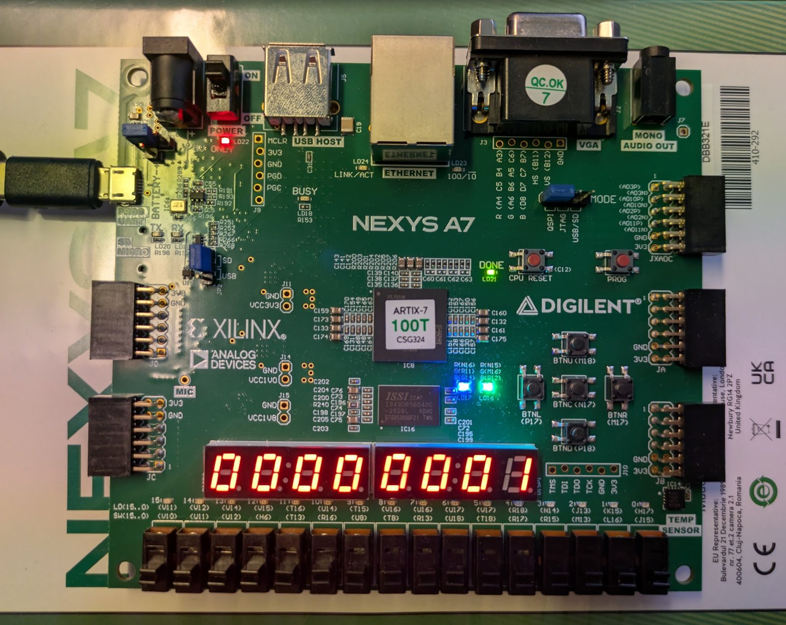
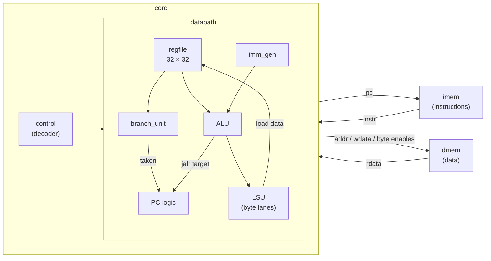
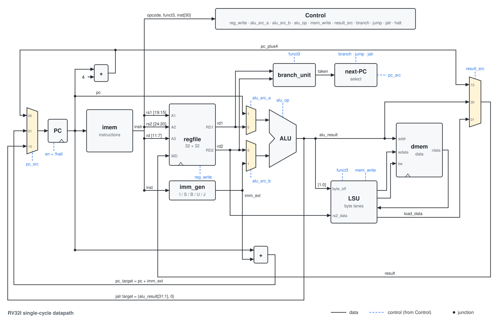
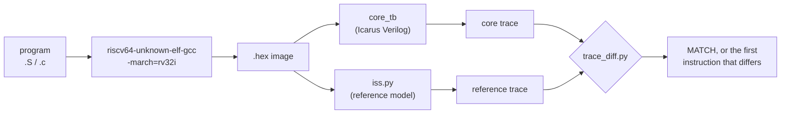
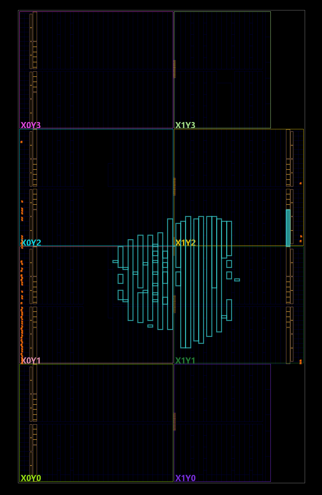

# RV32I Core

A single-cycle RISC-V processor in SystemVerilog. It implements the full RV32I
base integer instruction set, is verified instruction by instruction against a
reference model, and runs compiled C programs on a Digilent Nexys A7 FPGA.



*The N-Queens benchmark (compiled C) after running on the board: `00000001` = PASS, LD16 green = PASS, LD17 blue = halted.*

## Highlights

- **Complete RV32I:** all 40 base instructions. `fence` is a no-op, and `ecall` / `ebreak` halt the core.
- **Passes the official [riscv-tests](https://github.com/riscv-software-src/riscv-tests)
  `rv32ui` suite (40 / 40).** `fence_i` and `ma_data` are excluded: they need the Zifencei extension and misaligned access.
- **Checked instruction by instruction:** every register write and store is compared
  against a Python instruction-set simulator. More than 535,000 instructions across all test programs, with zero mismatches.
- **Runs compiled C:** a recursive N-Queens solver built with GCC, including libgcc's software multiply.
- **Runs on an FPGA:** a Nexys A7-100T at 25 MHz, with memory-mapped LEDs, switches and a 7-segment display.
  It uses about 3,900 LUTs (6% of the chip) and has 12.5 ns of timing slack, so an estimated maximum clock of about 36 MHz.

## Architecture





*Datapath. Signal names match [`datapath.sv`](rtl/datapath.sv); the numbers on each multiplexer input are the select values that choose it.*

Every instruction completes in one clock cycle (CPI = 1). The design uses
separate instruction and data memories (a Harvard architecture), both
loaded with the same program image so that `.data` is in data memory.

| Module | Role |
|---|---|
| [`riscv_pkg`](rtl/riscv_pkg.sv) | Opcode and ALU-operation enums, `funct3` constants |
| [`control`](rtl/control.sv) | Main decoder: opcode / `funct3` / `funct7` → control signals and the ALU operation |
| [`datapath`](rtl/datapath.sv) | PC logic, operand and result multiplexers, and the wiring between the units below |
| [`regfile`](rtl/regfile.sv) | 32 × 32-bit registers, two read ports and one write port; `x0` is always 0 |
| [`imm_gen`](rtl/imm_gen.sv) | Immediates for the I, S, B, U and J instruction formats |
| [`alu`](rtl/alu.sv) | The 10 RV32I operations, plus pass-through of operand B for `lui` |
| [`branch_unit`](rtl/branch_unit.sv) | Decides whether each of the 6 conditional branches is taken |
| [`lsu`](rtl/lsu.sv) | Byte enables and lane placement for stores; byte selection and sign/zero extension for loads |
| [`imem`](rtl/imem.sv), [`dmem`](rtl/dmem.sv) | Asynchronous-read memories; `dmem` has byte-wide writes |
| [`core`](rtl/core.sv) | Top level: control + datapath |

The core is about 470 lines of RTL.

## Verification



Testing has four levels:

1. **Unit testbenches** ([`tb/`](tb/)): one for each building block, with directed checks of edge cases. These include the largest and smallest immediates, shift amounts above 31,
   writes to `x0`, signed and unsigned branch comparisons, and every byte lane for loads and stores.
2. **Directed assembly programs** ([`sw/`](sw/)): one for each instruction group, written while the core was being built up.
3. **riscv-tests `rv32ui`:** the official suite, run in a minimal custom environment
   ([`tests/env/riscv_test.h`](tests/env/riscv_test.h)) because the core has no CSRs.
4. **Board-level simulation** ([`fpga/nexys_top_tb.sv`](fpga/nexys_top_tb.sv)): runs a program on the full FPGA top level
   and decodes what the 7-segment display shows from its anode and segment pins.

At every program level, the testbench writes one trace line per instruction
(`pc instr rd=value mem[addr]=data`). The reference model writes the same format, and `trace_diff.py`
reports the first line that differs. That points at the exact instruction the
core got wrong, not just a final PASS or FAIL.

## Results

Benchmark: recursive N-Queens (counts all solutions for N = 1–8), compiled C.

| | |
|---|---|
| Instructions / cycles | 524,217 / 524,217 (CPI 1.0) |
| Run time at 25 MHz | 21.0 ms |
| Time in software multiply (`__mulsi3`) | 36% |
| Branches (share of instructions / share taken) | 24% / 69% |
| FPGA resources (Nexys A7-100T) | 3,894 LUTs (2,048 of them used as RAM), 1,177 flip-flops, 0 block RAM, 0 DSP |
| Timing at 25 MHz | worst setup slack +12.5 ns, so an estimated maximum clock of about 36 MHz |
| Critical path | PC → instruction ROM → register read → ALU → data RAM → load → register write; 27.4 ns, 81% of it routing |
| Power (Vivado estimate) | 0.23 W total, 0.13 W of it dynamic |

Full measurements, including the instruction mix, critical path, per-module utilization and power: [`docs/results.md`](docs/results.md).

## Running it on an FPGA

[`fpga/`](fpga/) wraps the core for the Nexys A7:

- an MMCM clock generator producing 25 MHz from the 100 MHz board clock
- reset synchronization
- memory-mapped I/O

| Address | Device |
|---|---|
| `0x0000_0000` | 16 KB RAM |
| `0x0000_0100` | Result register: `1` = PASS (LD16 lights green), anything else = FAIL (red); also shown on the display |
| `0x1000_0000` | LEDs (read/write) |
| `0x1000_0004` | Switches (read) |
| `0x1000_0008` | 7-segment display, 8 hex digits (read/write) |

The build runs Vivado in non-project mode from a single script; see [`fpga/README.md`](fpga/README.md).

<p align="center"></p>

*The placed design in Vivado's device view: the whole design fits in a small block near the centre of the xc7a100t. The orange marks along the edges are the I/O pins it uses.*

## Getting started

**Requirements:**
- [Icarus Verilog](https://github.com/steveicarus/iverilog) 12 or later
- the RISC-V GCC toolchain (`riscv64-unknown-elf-gcc`)
- Python 3
- PowerShell (the scripts are written for Windows)
- optionally, Verilator for linting and Vivado for the FPGA

```powershell
.\run_tests.ps1               # rv32ui suite (clones riscv-tests on first run)
.\run_tests.ps1 add           # one test, printing its trace
.\run_prog.ps1                # all programs in sw\, compared with the reference model
.\run_prog.ps1 queens         # one program
.\sim.ps1 alu                 # one unit testbench

.\fpga\build.ps1 queens -Sim      # simulate the FPGA top level
.\fpga\build.ps1 queens -Program  # build the bitstream with Vivado and load it onto the board
```

## Repository layout

```
rtl/      the core (synthesizable SystemVerilog)
tb/       unit testbenches and the core testbench
sw/       test programs in assembly and C, linker script, C startup code
tests/    riscv-tests environment (the suite itself is cloned into tests/riscv-tests)
tools/    reference model (iss.py), trace diff, hex conversion, simulation helpers, datapath diagram
fpga/     Nexys A7 top level, constraints, board testbench, Vivado scripts
docs/     measurements (results.md)
Media/    photos and diagrams
```

## Design decisions

- **The memories read asynchronously.** In a single-cycle core, the instruction fetch and the data
  load happen in the same cycle as everything else, so memory reads can't wait for a clock edge.
  On the FPGA, that means distributed (LUT) RAM rather than block RAM.
  At 16 KB it uses about 11% of the chip's LUT-RAM.
- **The program is part of the bitstream.** Instruction memory is a ROM, initialized when the design is built.
  Synthesis optimizes the core around that particular program: a program that uses only a few registers gets a smaller register file.
  The figures above are for the benchmark program.
- **No CSRs or traps yet.** `ecall` / `ebreak` halt the core. The riscv-tests run in a small
  custom environment that replaces the CSR-based startup code.
- **One result convention everywhere.** Programs report PASS or FAIL by storing to `0x100`.
  The simulation testbench, the reference model and the FPGA board all watch that address,
  so the same program image can be checked in simulation and on the board without changes.

## Roadmap

- [ ] M extension (`mul` / `div`): 36% of the benchmark is software multiply
- [ ] 5-stage pipeline with forwarding and hazard detection, using these results as the baseline
- [ ] UART and bootloader, so programs can be loaded without rebuilding the bitstream
- [ ] Zicsr and machine-mode traps
- [ ] Video out through VGA

## License

[MIT](LICENSE)
